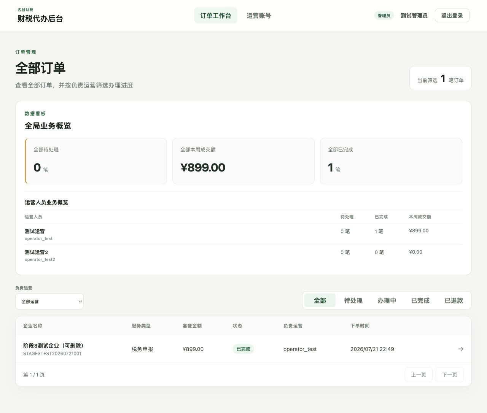
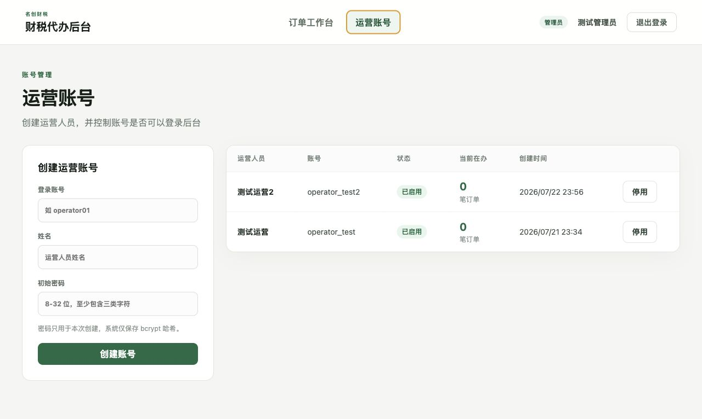
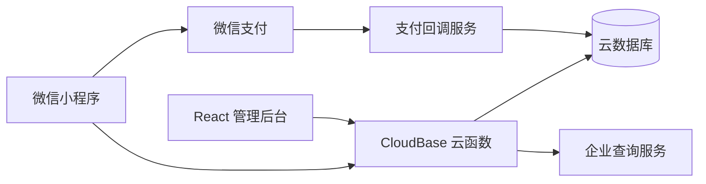

# 名企服务｜企业认证与财税代办微信小程序

一套基于微信小程序、腾讯云开发（CloudBase）和 React 的企业服务系统，覆盖企业查询、服务下单、微信支付、办理记录、投诉反馈及运营管理后台。

> WeChat Mini Program · Tencent CloudBase · Tax Service · Enterprise Service · React Admin

## 项目亮点

| 使用端 | 已实现能力 |
| --- | --- |
| 微信小程序 | 企业查询、企业信息展示、服务套餐选择、订单创建与支付、办理记录、联系客服、投诉反馈 |
| 运营后台 | 管理员/运营双角色登录、订单领取与跟进、状态流转、数据看板、运营账号管理、服务套餐管理 |
| 云端服务 | 20 个 CloudBase 云函数、云数据库集合与索引、JWT 鉴权、bcrypt 密码哈希、微信支付服务 |
| 工程质量 | 单元测试、端到端流程测试、安全校验、生产构建检查、敏感配置隔离 |

## 界面预览

| 订单工作台 | 运营账号管理 |
| --- | --- |
|  |  |

## 系统架构



## 技术栈

- 小程序：微信原生 WXML / WXSS / JavaScript
- 云端：腾讯云开发 CloudBase、Node.js 20
- 管理后台：React 19、Vite、CloudBase Web SDK
- 安全：JWT、bcrypt、角色权限、数据库条件原子更新
- 测试：Node.js Test Runner、生产构建检查

## 目录结构

```text
.
├── miniprogram/       # 微信小程序页面、组件与资源
├── cloudfunctions/    # CloudBase 云函数与微信支付服务
├── admin-web/         # React 运营管理后台
├── database/          # 集合、索引与 Schema 定义
├── scripts/           # 初始化、密钥生成与冒烟测试脚本
├── tests/             # 后端、权限和端到端测试
├── screenshots/       # 小程序预览码与后台界面截图
└── cloudbaserc.json   # CloudBase CLI 部署配置
```

## 快速开始

### 1. 环境要求

- Node.js 20 或更高版本
- 微信开发者工具
- 腾讯云开发环境
- 已开通对应能力的微信小程序账号

### 2. 获取代码并安装依赖

```bash
git clone https://github.com/sheryl666/tax-service-by-sheryl.git
cd tax-service-by-sheryl
npm install
npm --prefix admin-web install
```

支付服务有独立依赖：

```bash
npm --prefix cloudfunctions/payment2026-hg9hxxv0-demo-scfweb install
```

### 3. 配置微信小程序

```bash
cp project.config.example.json project.config.json
```

打开 `project.config.json`，将 `YOUR_WECHAT_MINIPROGRAM_APPID` 替换为自己的 AppID，再用微信开发者工具导入仓库根目录。真实配置已被 Git 忽略。

### 4. 配置 CloudBase

1. 在 `cloudbaserc.json` 中将 `envId` 改为自己的云开发环境 ID。
2. 复制管理后台环境变量示例：

```bash
cp admin-web/.env.example admin-web/.env.local
```

3. 在 `admin-web/.env.local` 中填写同一个 CloudBase 环境 ID。
4. 按 `database/collections.json` 创建集合和索引，并将业务集合权限设为“所有用户不可直接读写”。

### 5. 运行检查

```bash
npm run check:all
```

该命令会依次执行后端测试、语法检查、支付服务测试、管理后台测试和生产构建。

### 6. 启动管理后台

```bash
npm --prefix admin-web run dev
```

默认访问地址为 `http://127.0.0.1:5173`。

## 必需配置

敏感信息只应存放在本机配置、CloudBase 环境变量或部署平台的 Secret 中，不要提交到 Git。

| 配置项 | 用途 | 是否必需 |
| --- | --- | --- |
| `VITE_CLOUDBASE_ENV_ID` | 管理后台连接 CloudBase | 是 |
| `ADMIN_JWT_SECRET` | 后台 JWT 签名密钥，至少 32 位 | 是 |
| `TYC_TOKEN` | 企业查询静态 Token | 与 OAuth 二选一 |
| `TYC_CLIENT_ID` / `TYC_CLIENT_SECRET` | 企业查询 OAuth 凭证 | 与静态 Token 二选一 |
| `appId`、`merchantId` | 微信支付应用与商户标识 | 启用支付时必需 |
| `apiV3Key`、`merchantSerialNumber`、`privateKey` | 微信支付签名与回调解密 | 启用支付时必需 |
| `notifyURLPayURL` | 微信支付 HTTPS 回调地址 | 启用支付时必需 |

可在本地生成后台签名密钥：

```bash
npm run generate-jwt-secret
```

## 云数据库

核心集合：

- `orders`：订单、付款信息、负责人和状态日志
- `complaints`：用户投诉与处理结果
- `admin_users`：管理员及运营账号
- `service_products`：服务套餐、价格和上下架状态

集合与索引定义位于 `database/`。生产环境建议禁止客户端直接读写，由云函数统一校验身份和数据权限。

## 初始化管理员和服务套餐

创建初始管理员：

```bash
ADMIN_INITIAL_USERNAME="admin" \
ADMIN_INITIAL_DISPLAY_NAME="管理员" \
ADMIN_INITIAL_PASSWORD="请替换为强密码" \
npm run init-admin
```

初始化工商年报服务套餐：

```bash
npm run init-products
```

脚本会写入基础、升级和至尊三档套餐，后续可在管理后台修改名称、价格、说明及上架状态。

## 部署

首次部署云函数前，将安全密钥通过进程环境变量传入：

```bash
LANTERN_ADMIN_JWT_SECRET="$(npm run --silent generate-jwt-secret)" \
LANTERN_TYC_TOKEN="你的企业查询 Token" \
npx tcb fn deploy --all
```

只更新单个云函数代码时：

```bash
npx tcb fn code update adminLogin
```

部署管理后台：

```bash
npm run check:all
npm --prefix admin-web run build
npx tcb hosting deploy admin-web/dist -e YOUR_CLOUDBASE_ENV_ID
```

微信支付服务的完整配置与部署说明见 [`cloudfunctions/payment2026-hg9hxxv0-demo-scfweb/README.md`](cloudfunctions/payment2026-hg9hxxv0-demo-scfweb/README.md)。

## 权限与安全

- 后台业务登录使用 8 小时有效期 JWT，并实时校验账号状态。
- 密码仅保存 bcrypt 哈希，初始化脚本不输出明文或哈希。
- 管理员拥有全局数据和账号管理权限；运营仅能处理未分配或分配给自己的订单。
- 订单领取、状态更新和日志写入使用数据库条件更新，避免并发越权。
- 小程序订单按当前微信用户 `openid` 隔离。
- AppID、JWT 密钥、企业查询凭证及微信支付私钥均不应提交到仓库。

## 测试

```bash
npm test                 # 后端与权限测试
npm run test:e2e         # 订单端到端流程
npm run test:payment     # 微信支付服务测试
npm --prefix admin-web test
npm run check:all        # 完整检查
```

## 项目状态

当前版本已覆盖企业查询、财税服务下单、订单支付与跟进、用户反馈及后台运营的完整主流程。接入正式环境前，请替换示例配置并完成微信支付、企业查询服务和 CloudBase 权限的生产审核。

## 授权说明

本仓库目前尚未声明开源许可证。代码可公开浏览，但复制、修改、分发或商用前请先联系仓库所有者取得许可。
